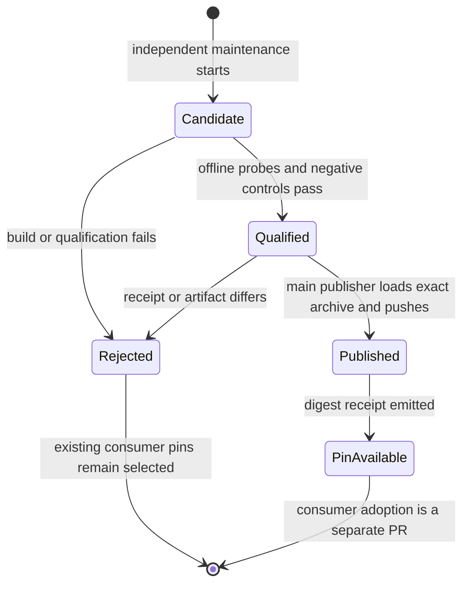

# System design

Size M. One approved design, one worker, one producer PR. No nested delegation.

## Existing delivery and choice

The existing workflow builds PostgreSQL images on recipe PRs and merge groups, qualifies one build, then rebuilds for publication. That makes merge validation depend on package sources and publishes different bytes from the tested artifact.

Two designs were considered. Separate workflows per capability repeat publication rules. A profile registry with one matrix pipeline shares qualification and publishes the exact saved image. Choose the registry. Existing PostgreSQL qualification remains the database and document tool contract.

The caller uses `python /opt/ci/capabilities.py verify PROFILE`. A profile owns expected Node, Playwright, PostgreSQL majors and tools. Recipes own acquisition. Verification owns no acquisition. Generated manifests own observed versions and package closure. Publication receipts bind recipe commit, qualified local image ID, registry digest and hashes of manifests and SPDX SBOMs. Consumers select literal digests in later PRs.

## Throughput checkpoint

- Blocking first steps. Read standing orders and existing producer contracts, then test failed promotion before implementation.
- Independent workstreams. Recipes, qualification and publication are coupled by one artifact contract, so one worker owns them.
- Shared mutable state. No consumer pin writes. Serialize maintenance runs, with at most two matrix builds active.
- Smallest safe decomposition. One profile registry, one verifier and one independent workflow retain existing database qualification.

## Operation

Weekly and manual main-only construction runs on free standard GitHub runners. PR and merge-group validation tests source and workflow contracts without constructing images. Candidate construction, offline qualification and archive precede publication. Publication loads the archived bytes instead of rebuilding. Every external operation has a workflow timeout and no retry loop. One failure stops that candidate and produces a failed run and logs. A failed run never edits consumer pins. No automatic redispatch exists.

At current and tenfold load, image pulls, disk and free-runner concurrency are expected limits, not measured benchmarks. Two builds at a time bound load. Images have no application database access, runtime factory dependency or N+1 queries. Build caches are optional and not correctness state. No eviction or digest deletion is implemented. Retain referenced digests and at least two predecessors. Revocation requires a consumer pin PR; no unqualified fallback exists.

Publication is asynchronous from code validation. The registry digest is immutable. A profile-and-commit tag is a publication locator, never a consumer selection. A run-specific candidate tag prevents collisions. Upload failure leaves the old selection usable. Registry failure blocks cold pulls, package-source failure blocks construction only. No mirror rewriting or runtime installer fallback is added. Credentials remain limited to the publisher job's ephemeral package permission. No production credentials or records are accessed.

## Statechart and tests

Tests cover failed qualification, wrong versions, missing tools, rejected digest receipts and successful promotion binding. Workflow tests cover main-only permission, no ordinary image build, offline execution, archive transfer and failure propagation. Hosted maintenance and publication proof run after merge, never from this branch.

## Scope and production proof

software-factory owns this producer. doctorcre-app migration is slice 2. carr-system migration is slice 3. The enforcement checker and factory consumer migration are later slices. Observe successful containing-commit CI, one scheduled image publication with qualification receipts, then an isolated failing candidate with unchanged consumer pins. This branch publishes no images and arms no merges.

## Design and debt pass

Codebase design concentrated receipt validation and pre-publication verification in one CLI. Zero tech debt removed the extra publication wrapper and the second image build. Source validation remains a test-only consumer of recipes. The artifact archive is the only image transfer between qualification and publication.

Transition coverage uses the Python tests `test_failed_candidate_never_creates_pin`, `test_versions_are_exact`, `test_missing_tool_refuses_without_installation`, `test_promotion_binds_qualified_bytes_and_recipe` and `test_preflight_cli_checks_artifact_hashes_before_any_publication`. Workflow tests cover independent maintenance, immutable actions, main-only package permission and every pinned consumer failure. Live container probes cover positive qualification and mutated missing-binary, wrong-version and absent-browser cases. Published job-container parity remains a hosted post-merge proof.
