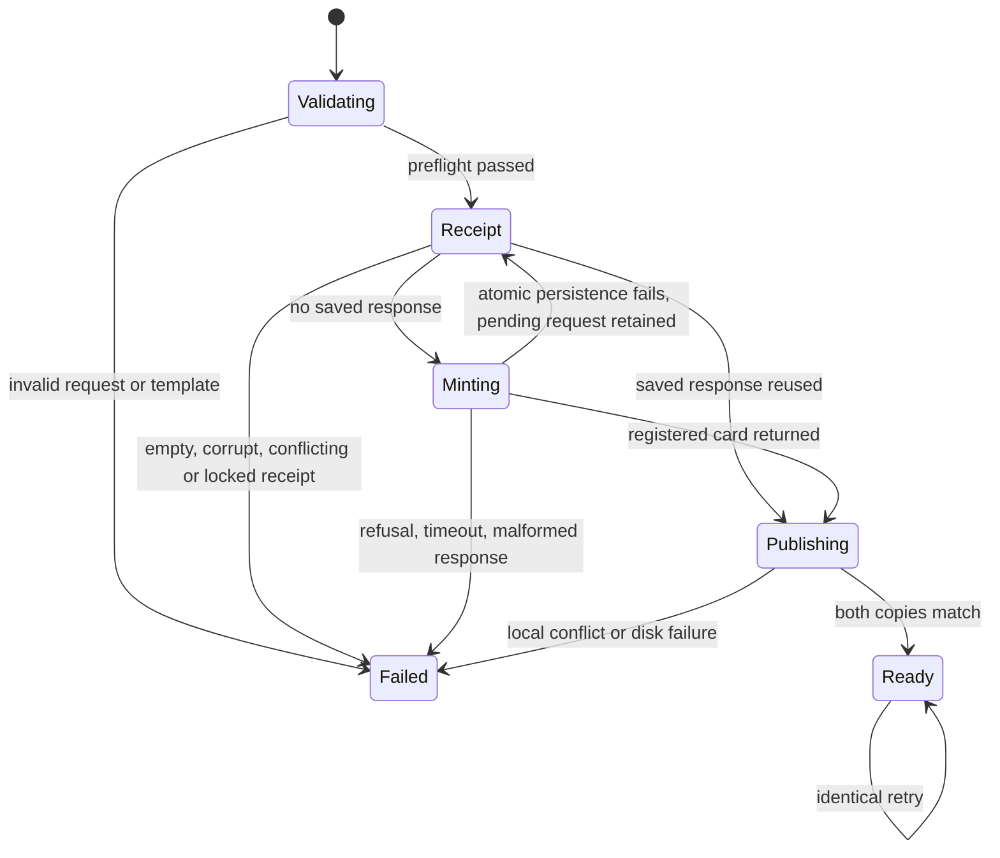

Size S. One command and four templates, one PR. No subagents by explicit brief.
Data shape: JSON request {card: dispatch-job arguments including UUID idempotency_key, template: enum, variables: string map}. Card fields stay under CARR validation authority.
Grounding: run.sh call emits a JSON success envelope; dispatch-job mints an idempotent queued card, starts no runner. T3 delegate_task accepts task text and isolation but no CARR mint/template fields. gh alias composes gh commands, not CARR writes. Existing skills/dispatch is prose plus native launch commands, no mint/render command.
Two interfaces considered: many flags per card field versus one JSON request file. Choose file input plus explicit path overrides; it preserves CARR's evolving schema and avoids shell interpolation. Python standard library only.
Throughput checkpoint:
- Blocking first steps. Live contracts, platform-first inspection and overlap check before code.
- Independent workstreams. n/a, single worker owns coupled command and tests.
- Shared mutable state. Per-card filenames; atomic replace and identical retry content; stable per-request lock file prevents conflicting local retries.
- Smallest safe decomposition. One worker; CLI tests exercise actual subprocess with synthetic run.sh, no production writes.
System design: CLI owns rendering and two brief files; CARR owns card identity/idempotency; coordinator owns T3 delegation. Template preflight occurs before one bounded 30-second external call. Fail closed, no automatic retries/fallback; nonzero exit is alert to caller. Caller reuses UUID after timeout. At most one mint call per invocation is the rate cap. No queues, network fan-out, credential storage, DB access, or cache. Files keyed by card id are tiny at current and 10x dispatch load; local disk and CARR latency break first. Same-request concurrent calls serialize with flock. Local receipt rejects changed request for the same UUID and caches the successful card response. Existing files must agree; retry repairs a missing copy. No stale success. Partial local writes recover on retry with same key.
Statechart:

Claim to measure: synthetic coordinator-facing preparation exchange bytes decrease with one command; not tokens, elapsed-time speed or quota prediction. Compare semantically identical mint and brief preparation, exclude unchanged delegate call. Verify generated copies and call count during measurement.

## Command reference

Run `python3 bin/coordinator-dispatch.py request.json`. A request has exactly
`card`, `template`, and `variables`. The card is the deployed `dispatch-job`
input with a caller-chosen UUID. Reuse it for the same intended job. A synthetic
complete request is in `tests/fixtures/dispatch/request.json`.

Templates are `build`, `review`, `fix`, and `open-held-branch` in
`bin/dispatch-templates/`. All use `goal`, `acceptance`, `production_proof`, and
`skills`. Review also uses `pr_url` and `head_sha`; fix uses `pr_url` and
`findings`; open-held-branch uses `branch`. Values are literal text.
`card_id` and the Card marker are reserved. The command supplies repository,
poteto-mode and standing-preferences paths. The paths derive from the current
home directory; specialist skills remain the coordinator's choice.

Defaults use `~/carr-system/run.sh call dispatch-job`, `/tmp`, and
`~/.claude/orchestrate/doctorcre-delivery/briefs`. `--carr-root`, `--tmp-dir`,
and `--brief-dir` override those roots for isolated tests. `--timeout` is a
positive call deadline up to 30 seconds. No credential is read by this wrapper.
CARR's runner owns authentication and authoritative card-field validation.

Success prints exactly `WRn.Sn.Jn /tmp/brief-WRn.Sn.Jn.md` and a newline.
Failure prints a diagnostic on stderr, exits nonzero, and prints no success.
The coordinator reads the brief and calls T3 `delegate_task` itself, retaining
its chosen provider, model, runtime options and worktree isolation. The wrapper
never starts a worker, arms a merge, or changes settings or hooks.

The brief archive owns a `.requests/<uuid>.json` receipt with the exact request,
rendering inputs and successful CARR response. A separate `.requests/<uuid>.lock` holds the nonblocking OS lock and rejects
concurrent reuse. A changed request or template under the same UUID refuses.
A successful mint is saved before publishing through fsync, atomic replacement and directory fsync. Cached responses are never rewritten. Empty existing receipts refuse. An identical retry reuses that
response and repairs a missing copy without a new CARR call. Existing different
brief content refuses. Each copy publishes atomically without overwriting.
The two copies are sequential, so a disk failure can leave one copy; only two
verified copies produce the success line. Do not delete receipts to retry.
A corrupt receipt refuses rather than guessing. An interrupted call with no
saved response must be reconciled using the same UUID within CARR's replay
window; this wrapper cannot make that remote transaction atomic with local IO.
No retry is automatic.

## Platform-first evidence

Inspected this session: T3 `delegate_task` and `orchestrator_capabilities` tool
schemas, `gh help alias`, repository `skills/dispatch/SKILL.md`, `tools/`, and
`lib/`, and deployed CARR `list-verbs` filtered to `dispatch-job`.
T3 accepts task text and execution settings; its inspected schema has no CARR
card mint or local template operation. GitHub aliases compose GitHub CLI calls.
The dispatch skill describes launch instructions. This command fills only the
CARR mint and local brief preparation gap. It does not replace delegation.

## Verification and measurement

`node --test tests/coordinator-dispatch.test.mjs` runs the CLI and validates the
synthetic card request against the captured deployed input schema and the pinned registered handler. The original invalid leading verb is a negative control. Exact CARR sources and SHA256 hashes are in `tests/fixtures/dispatch/carr/`. Authorization, storage and transaction envelopes are synthetic. The test executes the handler validation and result construction, not a local copy of its rules. The response
fixture is source-contract checked, uses synthetic identifiers, and passes the
production response parser. Its source revision is recorded beside it.

`python3 bin/measure-dispatch.py` executes five synthetic preparations and
checks one mint plus identical brief copies each time. The baseline serializes
the mint command and response plus the full brief write and copy operation.
The new exchange serializes the complete request-file contents, command and
one-line response. It counts compact JSON UTF-8 bytes, including shell argument
encoding. The unchanged T3 delegation, model envelopes, hooks, and internal
server traffic are excluded. The five runs measured 1,710 bytes before and
1,102 after, with zero errors. The ranges were identical to those values. Paths
contribute to these counts, so other checkout path lengths change the numbers.
This is a deterministic payload count, not a timing benchmark, measured token
usage or a prediction of subscription savings. No production mint was executed.

## Statechart transition coverage

- Invalid request/template to Failed: `test_preflight_refuses_before_mint`.
- Validating to Minting to Publishing to Ready: `test_mints_and_publishes_one_line`, `test_all_templates`.
- Minting to Failed: `test_refusal_and_malformed_success_do_not_publish`, `test_timeout_does_not_publish_or_retry`.
- Publishing to Failed: `test_file_conflict_refuses_without_success`, `test_partial_publish_repairs_on_same_key_retry`.
- Retry to Ready without minting: `test_retry_repairs_missing_copy_and_rejects_changed_request`, `test_partial_publish_repairs_on_same_key_retry`.
- Concurrent request to Failed: `test_concurrent_same_request_refuses_without_second_mint`.
- Literal template values: `test_literal_variables_are_not_executed_or_expanded`.

## Design and debt pass

Codebase-design compared flags with one structured request. One command hides
minting, rendering, response validation, publication and retry recovery. The
subprocess is the test seam; CARR keeps card schema and identity authority.
Zero-tech-debt kept one implementation and shared common brief text. There is
no new delegation, queue, credential store, or compatibility interface. These
new files replace repeated coordinator mint/write/copy calls; existing caller
migration belongs to the coordinator's adoption after merge.

## Read-only production proof

`bin/prove-coordinator-dispatch.py` runs from a trusted checkout of the delivered
revision. Its `--installed-root` identifies the separate coordinator installation.
It compares the command, templates and proof source bytes with the trusted
checkout. It reads the saved request receipt and both brief files, then makes
one `job-card-registration` call with a 30-second timeout. It requires the exact
card, executor, model and repository. It never calls `dispatch-job`.
The request file and `--card` must come from an already authorized dispatch.
The proof does not mint a new job or start a worker.

Invocation syntax is `python3 bin/prove-coordinator-dispatch.py REQUEST --card CARD --installed-root INSTALLATION`.
The request, card and installation are explicit inputs, not inferred from a
latest receipt. Defaults for CARR and brief roots match the builder command.
`--tmp-dir`, `--brief-dir` and `--carr-root` support isolated deployments.
Local reads refuse artifacts above 1 MiB. There are no loops, retries or queues.
One process handles one card at current and 10x load. Local IO and CARR latency
remain the limit. A missing or inconsistent artifact, failed registration read
or identity mismatch exits nonzero. The caller receives the diagnostic.

`--registration-file` substitutes a contract-checked response for offline
controls. Its output explicitly says `fixture`, so it cannot attest production.
`test_read_only_proof_pass_and_failure_controls` executes the CLI with positive,
unregistered, wrong-card, wrong-repository, refused and brief-tampering cases.
`test_proof_rejects_different_installed_identity` checks the installed identity.
`test_proof_live_reader_calls_only_registration_once` executes the production
read path against a synthetic runner and checks the exact verb and call count.
The pinned handler also constructs and validates the registration fixture.

CARR production-proof admission currently cannot classify software-factory
paths or register this runner. Its registry is held by open CARR PRs 3022,
3023 and 3024, so this worker does not change it. The local admission result
is a refusal, not acceptance or production evidence. The coordinator must
resolve that admission dependency before claiming the full acceptance complete.
No `/release` read is required for this installed CLI proof.

## Recovery transition coverage added in review

| Transition | Test |
| --- | --- |
| Validating to Receipt | `test_mints_and_publishes_one_line` |
| Receipt to Minting | `test_mints_and_publishes_one_line` |
| Receipt to Publishing | `test_retry_repairs_missing_copy_and_rejects_changed_request` |
| Receipt to Failed | `test_empty_existing_receipt_refuses_without_remint`, `test_corrupt_receipt_refuses_before_mint`, `test_concurrent_same_request_refuses_without_second_mint` |
| Minting to retained pending receipt on persistence failure | `test_atomic_receipt_failure_preserves_pending_request` |
| Ready to Ready without any receipt write | `test_cached_retry_never_rewrites_saved_response` |

The root-cause pass replaces receipt truncation with atomic persistence under a
stable lock. The design pass keeps card semantics authoritative in CARR and
executes pinned CARR source in tests. The debt pass avoids a second verb catalog
or orchestrator. The extra source fixture is exact pinned test data, not a
production dependency. Existing test suites cover the additions, so no new
suite or CI-duration registry entry is introduced.
