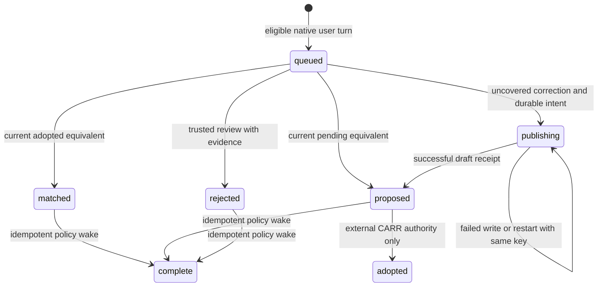

# Session correction capture

## System design

This S-sized slice belongs to software-factory. CARR owns doctrine, adoption,
authentication, and product dispatch. The factory owns local capture and the
sponsored orchestration consumer. No product imports this module.

The data shape is a durable review item with a native session, source turn,
verbatim user text, source digest, disposition, publication intent, and receipt.
Capture retains every eligible user turn. A keyword filter cannot establish
whether a correction is genuine. User-role attribution alone is also insufficient.
A trusted sponsored reviewer must separate direct corrections from quotations,
examples, and delegated briefs. Source text is data, never executable instructions.

Two designs were considered. Per-event JSON files eliminate a shared database but
need a second coordination mechanism for publication and concurrent consumers.
SQLite provides unique identities, atomic inserts, and a single consumer lock.
Choose SQLite with bounded batches and short capture transactions. A separate
advisory consumer lock spans remote effects, preventing two local consumers from
publishing equivalent proposals before either can observe the other's receipt.

Caller sketch follows. Capture accepts an explicit transcript, provider, session,
and queue. consume accepts a trusted sponsor adapter. The adapter supplies current
rules and pending proposals, review judgments, write calls, and an orchestrator
wake. These are process dependencies, never paths or commands from transcript text.
The consumer has no adoption method. Adoption remains a separate authorized CARR
`adopt-rule` call. A model confidence score has no state transition.

## Ownership and authority

The hook ships disabled. No settings installer or default transcript discovery
exists. Stop and SessionEnd callers supply the same session and transcript.
Claude native `user` records exclude sidechains and tool results. Codex accepts
only `response_item` user messages from matching non-subagent session metadata.
Origin vetoes are ported from CARR `ops/corrections-sweep.py` and its
`tools/displacement-baselines.py` dependency at
`5422371aa23e6966b5e79635d4352821b0dd362f`. Leading machine wrappers veto the
whole record, so removing a header cannot promote a tool body into partner text.
All native user turns remain untrusted until review, including quoted material.

The trusted sponsor adapter obtains its own authenticated attach context and
asserts read_write access independently of transcript or hook payloads. The hook
never attaches or writes records. A read_only consumer fails before any callback.
CARR repeats authentication and access checks on the actual publication call.

The current source places `adopt-rule` in `mcp-server/src/org-conventions.js`,
not `doctrine.js`. Proposal writes use `write-doctrine-section`, document
`team-memory`, section `conventions/proposed/<deterministic slug>`, base version 0,
with the sponsor's attach ID. Only a successful receipt records a draft. Drafts
never count as enforced. Rule matches require an active adopted rule from a fresh,
complete sponsor snapshot. Matching wording is the trusted reviewer's semantic
judgment with anchored evidence, not a local bag-of-words decision.

## Capacity and queue flow

One session-end producer reads only its supplied file, bounded to 8 MiB and
20,000 rows. Overflow or malformed native data fails visibly without partial
capture. At most 100 items are consumed per wake. Each publication has a stable
UUID idempotency key and persisted exact arguments before sending. Sponsor
transport must impose its own timeout and obey provider rate limits. There are no
background threads, retries in a loop, or new schedules. Existing orchestration
wakes invoke the consumer and then the existing policy. Policy determines
headroom, eligibility, and dispatch; capture neither invents a slot cap nor
selects a job. The wake callback must converge on its supplied receipt key.

A session and source-turn identity form the unique queue key. Repeated Stop,
SessionEnd, concurrent sessions, and restarts converge. A changed body for an
existing identity is rejected, rather than overwriting evidence. SQLite serializes
capture while the separate consumer lock serializes review and publication.
Before every fresh judgment, the sponsor reads current adopted rules and pending
proposals. Equivalent adopted rules match. Equivalent pending drafts link as
proposals without gaining enforcement. Uncovered corrections become proposals.
Rejections require evidence. Every source turn has its own disposition.

## Failure and recovery

A write failure leaves the exact intent retryable. A crash after remote success
replays identical arguments and idempotency key. Two consecutive failures with the
same stable cause create one visible diagnosis row. Diagnosis does not disable
retry. Errors are reported by stage and exception type, avoiding credential-bearing
transport messages in the queue. A wake failure retries the wake without repeating
a successful write. Queue inspection exposes unfinished work and diagnoses.
Local state belongs in a private directory outside source control. It contains
partner text and must follow the operator's retention policy.

## Statechart

`adopted` is outside the factory machine. Its receipt does not follow from a
proposal or confidence. Each transition has an executable synthetic test.
Formal TLC checking is not claimed. The chart omits SQLite's internal lock states.

## Verification limits

Tests reuse the scanner's synthetic native-origin cases, add capacity paraphrases,
quotations, delegate briefs, malformed inputs, duplicate events, competing
sessions, crash replay, failed writes, diagnosis, and read_only authority checks.
A sponsor fixture exercises the policy wake contract with a ready queue and
headroom. It cannot prove a deployed orchestrator follows the rule. Production
proof belongs to WR839.S6.J3 and requires a real anchored correction plus the next
applicable dispatch. Stored drafts alone fail that proof.

Throughput checkpoint is one builder with one branch. No independent work is
launched because the brief forbids subagents. Capture and consumer tests run
locally before the repository check and hosted CI.

## Sponsored consumer interface

A trusted process calls `consume(queue, sponsor, limit=100)`. Its adapter implements
these methods and attributes. Transcript content cannot construct this adapter.

- `access` and `attach_id` come from the authenticated sponsor's attach context.
- `snapshot()` returns `complete`, `rules`, and `proposals`. A complete snapshot
  includes all applicable current rules and pending proposals, not a search's top
  results. Rule entries have `id`, `status`, and a verified `adopted` boolean.
  Pending proposal entries have `id` and `status=proposed`.
- `review(item, snapshot)` returns `kind` and nonempty `evidence`. Kind `reject`
  explains the quoted, machine, delegated, or non-correction evidence. Kind `match`
  adds a `ref` from the snapshot. Kind `propose` adds a single-line `statement`
  only after semantic comparison finds no covering rule or pending proposal.
- `call(verb, args)` invokes the authenticated CARR contract, applies timeouts,
  preserves the idempotency key, and returns the unwrapped JSON receipt.
- `wake(key)` re-enters the existing orchestrator policy idempotently and returns
  `ok=true` only after a durable wake receipt. The orchestrator, not the adapter,
  reads ready jobs, measures headroom, and dispatches eligible product work.

`adopted_match` means the reference was active and adopted at review. It does not
claim operational enforcement. `complete` means disposition and wake receipt,
not production success. The implementation provides this integration interface;
it does not install a concrete authenticated sponsor or change an orchestrator.
The existing-policy outcome acceptance remains unverified until the coordinator
binds that interface to its actual orchestration consumer. The synthetic sponsor
is an interface test and must not be cited as that outcome test.

Queue inspection returns at most 1,000 items and diagnoses, with total and
unfinished counts. Capture takes an immediate SQLite transaction before checking
source identity, so concurrent conflicting identities cannot silently converge.

## Delivery review

Codebase design pass keeps native parsing and durable review in one deep module
behind capture, consume, and inspect operations. The distinct native formats
justify adapters within that module. The two whole-shape designs appear above.
Debt pass finds no older correction implementation or callers to retire in this
repository. Added code replaces manual session-end evidence capture. It does not
replace CARR rule authority or introduce a parallel scheduler. Comment review
adds no inline commentary or suppression directives. Independent review is still
required. No agents were spawned under the worker's explicit no-subagent order.
