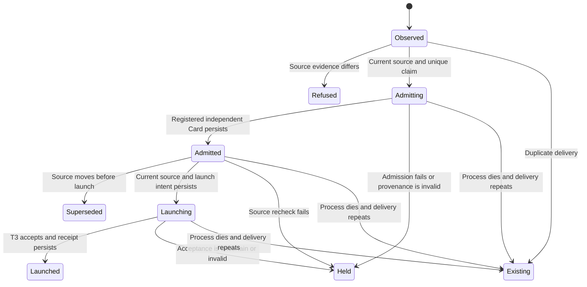

# Source CI review admission

The factory consumer admits at most one review request per CARR PR source head. It consumes the existing `carr-source-ci-review-candidate.v1` artifact. This source slice is not an installed automatic reviewer. The trusted host integration and signed delivery still need implementation and production verification.

## System design

`Consumer.consume(candidate, host)` owns the admission state machine and a SQLite ledger. CARR owns candidate collection, registered Cards and builder provenance. T3 owns independent reviewer execution and worktrees. GitHub owns source-CI completion events. The consumer never submits a verdict or arms a merge.

The typed data shapes are `Binding`, `Launch` and the validated candidate dictionary. Binding identifies registered builder and reviewer Cards and their execution principals. Those principals must differ. A PR author is not builder provenance. A host must resolve the actual registered job records, select the reviewer principal at launch and attest the returned task belongs to it.

Two interfaces were considered. A consumer with `collect`, `admit` and `launch` adapters keeps credentials and platform configuration on the trusted host. A privileged hosted workflow would place CARR and T3 launch authority in GitHub. The first interface preserves the existing producer's security split. No new runner, queue or scheduler is introduced.

The caller supplies one persistent ledger outside disposable worktrees. Unique-key insertion selects one owner across simultaneous deliveries. Each committed state precedes its corresponding external side effect. SQLite synchronous FULL protects committed claims against process death under the filesystem's durability guarantees. Losing, replacing or restoring an older database invalidates the deduplication guarantee. Keep the database with the host's durable application state and never shard a key across separate stores.

One delivery performs at most two collector calls, one Card admission and one T3 launch, sequentially, with no retries or fan-out. The host must bound each platform call with a deadline and provider admission. Collector calls reuse the pinned CARR collector, whose GitHub reads are bounded and exclude review-gate. There is no cache, scan, N+1 lookup or background loop. Each ledger lookup uses the primary key. Tenfold load increases SQLite write contention and host/provider admission pressure; this slice does not claim measured host capacity. A database lock waits at most five seconds, then fails rather than making an unrecorded launch.

The first error after a claim holds the request. This is stricter than the program's two-failure ceiling. A process death preserves `admitting`, `admitted` or `launching`; redelivery returns that state without another side effect. There is no automatic lease expiry. Expiry cannot distinguish a slow accepted launch from a lost response. Reconciliation must establish the original Card and T3 request identity before recording a terminal result. It must never delete the claim merely to retry.

A collector outage before claim fails without launching. Source mismatch refuses before admission. Source mismatch after admission persists `superseded`. A final source check runs immediately before the persisted launch intent. GitHub can move the head after that check; the review prompt binds the immutable head, and the existing verdict gate must refuse stale attestations. No cross-system atomicity is claimed.

## Trusted host interface

The executable accepts an explicitly configured Python module exporting `host`. That module is trusted installed code, never a path or instruction from the event payload. The event handler must authenticate its GitHub-to-T3 signed delivery before invoking the consumer. No host module is supplied in this slice.

| Method | Required behavior |
| --- | --- |
| `collect(run_id, attempt)` | Reexecute CARR's existing collector from a pinned trusted revision against live GitHub metadata. Return its exact candidate or refusal. Never trust success fields in the downloaded artifact. |
| `admit(candidate, request_key)` | Resolve the registered builder job and independent reviewer principal. Mint the reviewer Card through existing CARR dispatch-job. Return `Binding`. Use stable request identity in CARR admission and record its response. Unknown provenance refuses. |
| `launch(request, binding)` | Invoke existing T3 delegate_task using the binding's reviewer principal and configured provider/model. Forward the generated Card-bearing task, role, worktree isolation and clientRequestId. Verify acceptance and return `Launch(task_id, thread_id)`. Never grant reviewer credentials for verdict submission or merge. |

The factory executable verifies its library and launcher bytes against its checked-out Git revision before consuming. The host must separately pin CARR collector and host-module revisions. Candidate strings cannot select modules, tools, provider settings or prompts. Only validated public identifiers enter the fixed review prompt.

Candidate review rounds are fixed at one because the existing producer only emits round one. A later source head gets a new key and a new independent review. Same-head CI reruns keep the original receipt, including its original source evidence attempt. Additional same-head semantic review rounds require a future explicit producer contract, not an arbitrary payload override.

## Statechart

| Transition | Executable test |
| --- | --- |
| Observed to Refused | `test_moved_head_and_forged_artifact_never_admit`, `test_failed_or_refused_collector_never_admits` |
| Observed to Admitting, Admitting to Admitted, Admitted to Launching, Launching to Launched | `test_green_source_launches_with_card_and_no_review_gate` |
| Observed to Existing | `test_duplicate_after_restart_and_ci_rerun_launch_once`, `test_concurrent_duplicates_have_one_owner` |
| Admitting to Held | `test_independence_and_card_validation`, `test_uncertain_admission_or_launch_is_held_without_retry` |
| Admitted to Superseded | `test_head_moves_during_admission` |
| Admitted to Held | `test_recheck_failure_holds_without_launch` |
| Launching to Held | `test_uncertain_admission_or_launch_is_held_without_retry` |
| Admitting to Existing after process death | `test_process_death_during_admission_never_mints_another_card` |
| Admitted to Existing after process death | `test_process_death_after_card_persist_never_relaunches` |
| Launching to Existing after process death | `test_crash_before_and_after_paid_acceptance_never_relaunches` |
| Later head to a new admission | `test_new_head_gets_independent_review` |

These are executable state-machine tests, not a TLA+ proof or a live platform experiment. Fixture candidates use the same validator as production consumption. Binding and Launch fixtures pass the same typed response validators as host responses. No fixture implies a real registered Card or accepted T3 job.

## Production proof

Source tests cannot prove automatic operation. After a trusted host adapter and signed event delivery are installed, a normal CARR PR must produce one review task without a coordinator turn while review-gate remains red. Replay that exact delivery and a source-CI rerun. The durable receipt must preserve one reviewer Card and T3 task. Move the source head before admission and verify no launch. Complete source CI on a later head and verify a new independent review.

The read-only `receipt` subcommand reads the ledger without creating or modifying it. `prove` checks receipt bindings against a candidate and expected full factory revision. It exits nonzero for missing launch, wrong head, invalid independence or wrong revision. It explicitly reports `remote_execution_verified=false`; the production verifier must also check registered CARR job provenance and the real T3 task. Local tests run this proof CLI with passing and failing fixtures. A receipt alone is not live proof.

No schedule, secret, credential, reviewer job, production record, native review or merge was created by this source slice. Factory CI uses `npm run check`, which discovers the Node wrapper for the Python suite. The factory has no CARR strict-check script, duration registry or production-proof admission contract. Those CARR files must not be copied here to manufacture a passing gate.
